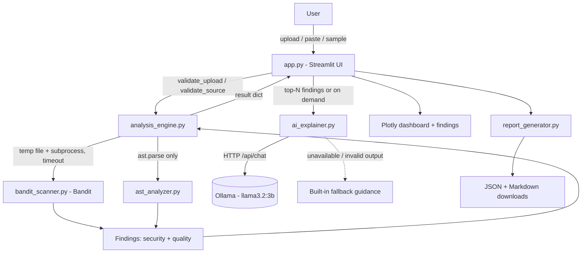

# 🛡️ CodeSentinel AI – AI-Powered Code Review & Security Scanner

CodeSentinel AI analyzes Python source code, detects **security vulnerabilities** (Bandit) and **code quality issues** (Python AST), explains each finding with a **local LLM** (Ollama + Llama 3.2) and suggests safer code. Everything runs on your machine: no paid APIs, no database, no accounts.

## Problem statement

Security scanners print terse rule IDs; reviewers then have to work out *why* a finding matters and *how* to fix it. CodeSentinel AI combines deterministic scanners (no hallucinated findings) with an LLM that only **explains** what the scanners actually found, and falls back to built-in guidance when no model is available.

## Features

- **Input**: upload a `.py` file, paste code, or load a bundled sample. Extension, size (default 512 KB), UTF-8 encoding and null bytes are validated; the code is displayed with line numbers.
- **Security analysis (Bandit)**: hardcoded credentials, `eval`/`exec`, shell/subprocess misuse, weak hashes, insecure temp files and permissions, pickle/YAML deserialization, SQL string building, disabled TLS verification and more. Each finding shows severity, confidence, line, CWE, description and remediation taken from the real scanner result.
- **Code quality (AST)**: missing docstrings, too many parameters, broad/bare `except`, cyclomatic complexity, long functions, deep nesting. Shown as separate **Quality** findings (`CS-Qxxx`), never mixed up with security issues.
- **AI explanations**: configurable Ollama host/model (default `llama3.2:3b`). Each explanation contains the issue, its impact, a safer approach and corrected code. Responses are validated as JSON (one retry); if Ollama is down, the model is missing or the output is invalid, built-in guidance is used and labelled as such. Generated code is **never executed** (it is only syntax-checked with `ast.parse`).
- **Dashboard** (dark theme): totals, severity distribution, security vs quality, findings by category, filters, searchable details with remediation, source view with flagged lines.
- **Export**: complete **JSON** and **Markdown** reports.

## Technology stack

Python 3.11+ · Streamlit · Bandit · `ast` · Ollama (Llama 3.2) · Pandas · Plotly · Requests · pytest

## Architecture



## Project structure

```
app.py                      Streamlit dashboard
analyzer/
  models.py                 Finding dataclass
  bandit_scanner.py         Bandit via subprocess (temp file, timeout, JSON parsing)
  ast_analyzer.py           Code quality checks (AST)
  analysis_engine.py        Validation, orchestration, summary statistics
  ai_explainer.py           Ollama client, response validation, fallbacks
  report_generator.py       JSON / Markdown reports
samples/                    vulnerable_sample.py, secure_sample.py
tests/                      test_analyzer.py, test_reports.py
.streamlit/config.toml      Dark theme, upload limit
```

## Installation and execution

```bash
# 1. (recommended) create a virtual environment
python -m venv .venv
source .venv/bin/activate        # Windows: .venv\Scripts\activate

# 2. install dependencies
pip install -r requirements.txt

# 3. run the app
streamlit run app.py
```

Open http://localhost:8501.

### Enable AI explanations (optional)

```bash
# install Ollama from https://ollama.com, then:
ollama pull llama3.2:3b
ollama serve            # usually already running as a service
```

Change the host or model in the sidebar, or copy `.env.example` to `.env` (`OLLAMA_HOST`, `OLLAMA_MODEL`, `MAX_UPLOAD_KB`, `BANDIT_TIMEOUT`). Without Ollama the app still works and shows built-in explanations.

### Run the tests

```bash
python -m pytest -q
```

## Sample output

Scanning `samples/vulnerable_sample.py` (Bandit 1.9.4):

```
29 findings - 20 security, 9 code quality   |   HIGH 4 · MEDIUM 12 · LOW 13

F001 HIGH   L29  B324     Weak Cryptography         md5 used for password hashing
F002 HIGH   L34  B602     Command Injection         subprocess with shell=True
F003 HIGH   L61  B501     TLS/SSL Misconfiguration  requests verify=False
F004 HIGH   L71  B103     Unsafe File Operations    chmod 0o777
F006 MED    L39  B307     Code Injection            eval()
F007 MED    L44  B301     Insecure Deserialization  pickle.loads
F008 MED    L50  B506     Insecure Deserialization  yaml.load
F009 MED    L55  B608     SQL Injection             string-built query
F015 MED    L87  CS-Q004  Complexity                cyclomatic complexity 13
F016 MED    L87  CS-Q006  Complexity                nesting depth 5
F019 LOW    L17  B105     Hardcoded Credentials     DB_PASSWORD literal
...
```

Scanning `samples/secure_sample.py` produces **0 findings**.

Report excerpt (Markdown export):

```markdown
### 1. [HIGH] B324: Hashlib (line 29)
- **Severity / Confidence:** HIGH / HIGH
- **Category:** Weak Cryptography
- **CWE:** CWE-327

Use of weak MD5 hash for security. Consider usedforsecurity=False

**Remediation:** Use SHA-256 or stronger, and a dedicated password hash (PBKDF2, scrypt, argon2) for credentials.
```

## Safety design

- Uploaded code is **only parsed (`ast.parse`) and scanned by Bandit** – it is never imported, compiled or executed.
- Bandit runs with `shell=False`, a fixed argument list, a timeout and an isolated temporary directory that is deleted afterwards.
- Code sent to the LLM is framed as untrusted data; model output is schema-validated and length-limited; generated code is displayed, not run.
- Everything stays local (Ollama on `localhost`).

## Limitations

- Python only; no cross-file or data-flow analysis (Bandit is pattern-based, so false positives/negatives are possible – confidence is shown for each finding).
- Single-file analysis; max size configurable (default 512 KB).
- Small local models can give generic or incorrect advice; always review suggested code. Explaining many findings is slow on CPU, so only the top N (default 5) are explained automatically and the rest on demand.
- Remediation text for Bandit findings is a curated table keyed by Bandit test ID; unknown IDs get a generic hint plus the Bandit reference link.
- Analysis results live in the Streamlit session only (nothing is persisted).

## Future improvements

- Multi-file / repository and ZIP scanning, `git diff` review mode.
- Additional scanners (Ruff, pip-audit for dependencies, secret detection).
- SARIF export and a CI / pre-commit mode.
- Optional auto-fix patches with diff preview and re-scan verification.
- Trend tracking across scans, and support for more languages.

## License

MIT – use freely for learning and internal tooling.
